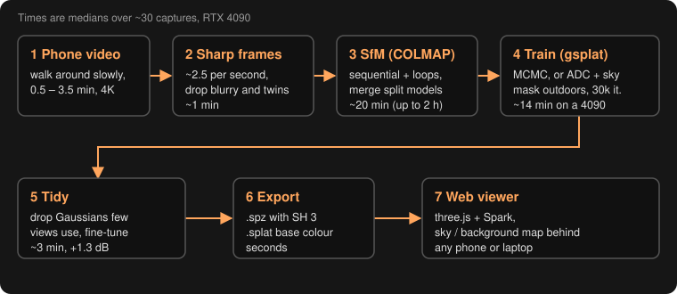
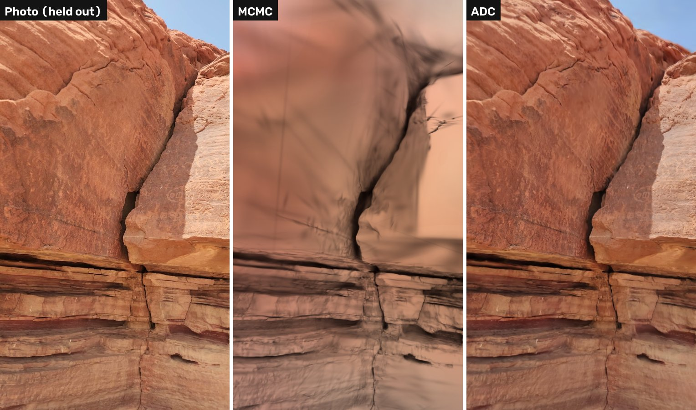
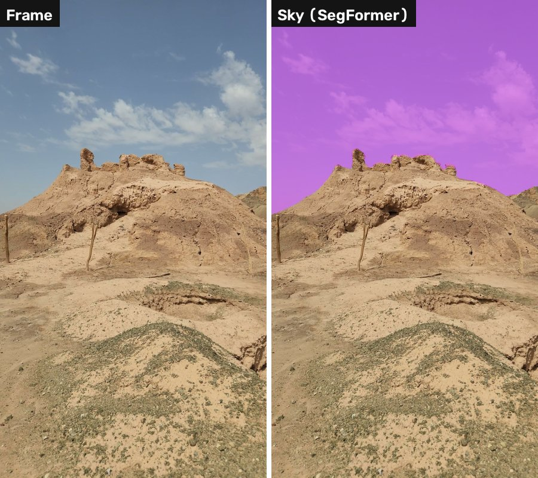
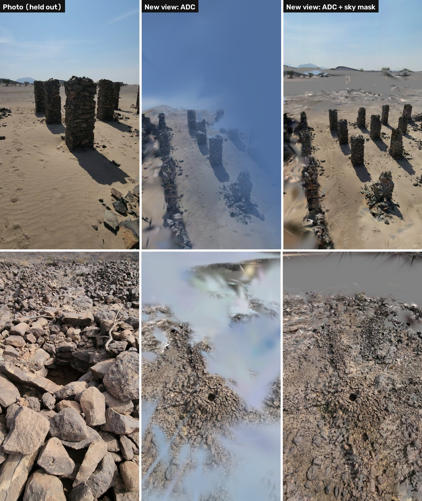
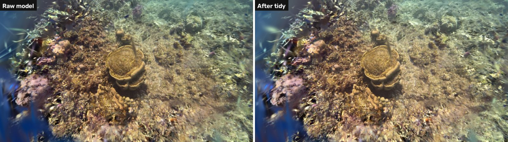
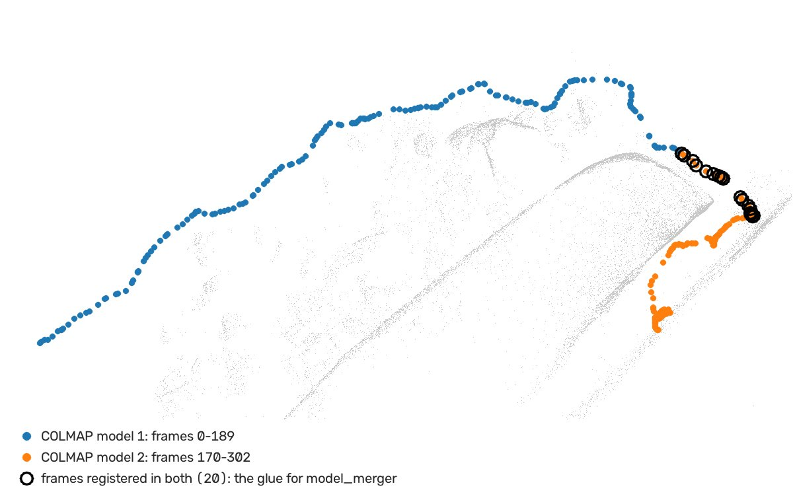
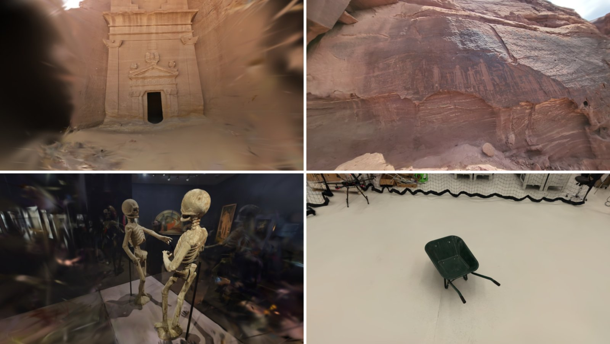

In the last weeks we have been turning phone videos into [3D Gaussian Splatting](https://repo-sam.inria.fr/fungraph/3d-gaussian-splatting/) (3DGS) models, around 30 of them: objects in a museum, rock art, a wheelbarrow, a coral reef, ruins and tombs under the strong desert sun. We made quite some mistakes on the way, so here goes the guide I would have liked to read before starting. The pipeline we ended up with, what each step does, what helped, what did not, and how long everything takes.

It is for people who know a bit of computer graphics or computer vision, but never built a splat from their own videos.

## What is a Gaussian splat, in two paragraphs

A 3DGS model is a cloud of millions of small, semi-transparent, coloured 3D ellipsoids (the Gaussians). To render an image you project them to the screen, sort them by depth and blend them. It is fast enough for real time, even in a browser, and it looks like a photo, not like a mesh.

To get the Gaussians you need photos of the scene, and also the exact camera pose of each photo. Then an optimizer moves, scales, recolours, adds and removes Gaussians until the renders match the photos. So there are two halves: first find the cameras, then train the splat.

## The pipeline

1. **Video.** A normal phone video in 4K, walking slowly around the thing. Ours go from 23 seconds to 3.5 minutes, one minute in the median.
2. **Frames.** We take about 2.5 frames per second of video (between 150 and 600 in total), and in each time window we keep the sharpest one, using the variance of the [Laplacian](https://pyimagesearch.com/2015/09/07/blur-detection-with-opencv/), a classic blur measure. We also drop frames that are almost the same as the previous one. Motion blur is the first enemy here, a blurry frame teaches the model a blurry scene.
3. **Structure from Motion (SfM)** with [COLMAP](https://colmap.github.io/) 4. It finds feature points, matches them between frames and solves the camera poses, plus a sparse point cloud. For video the right choice is the *sequential* matcher (each frame is matched with its neighbours), with loop detection on, so it also notices when you come back to a place you already filmed.
4. **Training** with [gsplat](https://github.com/nerfstudio-project/gsplat), 30,000 iterations. I talk about the densification strategy below, because this is where the outdoor scenes broke.
5. **Tidy.** A cleanup pass we wrote ourselves: remove the Gaussians that almost no training view really uses, and fine-tune a bit.
6. **Export** to [.spz](https://github.com/nianticlabs/spz) (compressed, keeps the view-dependent colour) and to plain `.splat` (only base colour, smaller).
7. **Web viewer** with [three.js](https://threejs.org/) and [Spark](https://sparkjs.dev/), so anybody can open the model on a phone or a laptop.

We leave about one frame of every eight out of the training, as test views. All the PSNR numbers below are on those views (higher is better; around 20 dB is "you can recognise it", 25+ is good, 30 is very good).

## Timings

Medians over our captures, on one RTX 4090:

| Step | Typical time | Notes |
|---|---|---|
| Frame selection | ~1 min | |
| SfM (COLMAP) | ~20 min | 250 frames; it grows fast with more frames, our longest took 2.3 h with 540 |
| Training (30k iterations) | ~14 min | 1.5 million Gaussians |
| Tidy + fine-tune | ~3 min | |
| Export | seconds | |

So more or less 40 minutes from video to model for a one-minute clip. The slow part is the SfM, not the training, which surprised me a bit. GPU memory while training was 7 GB in the median, 21 GB in the worst case.

## What worked

### Classic densification (ADC) for outdoor scenes

The optimizer needs some strategy to decide where to add and where to remove Gaussians, and gsplat comes with two:

* **ADC** (adaptive density control), the [original one from the 3DGS paper](https://arxiv.org/abs/2308.04079). It splits or clones Gaussians with large gradients, prunes the transparent and the very big ones, and resets all opacities from time to time.
* **MCMC** ([Kheradmand et al., 2024](https://arxiv.org/abs/2404.09591)). It treats the Gaussians as samples of a distribution, keeps a fixed budget and moves the "dead" Gaussians to where they are needed. In benchmarks it is usually better, and it was our default.

And MCMC was great for objects and indoor scenes. But four of our outdoor captures collapsed completely, with test PSNR between 7 and 12 dB, renders that look like a blurry painting. The SfM was fine in the four of them (92–100 % of the frames registered, sub-pixel error), so the cameras were not the problem.

*Same cameras, same frames, and this is a milder case. MCMC (middle) gets the lower layers of the rock, but a few huge Gaussians close to the camera smear everything above. ADC (right) is sharp. In the four worst captures the whole image looked like the top half here.*

The reason is the sky. The bright sky has to be painted by Gaussians, because there is nothing behind them. MCMC grew a few gigantic Gaussians very close to the cameras, bigger than the whole scene, and never removed them, since it has no rule to prune Gaussians that are huge on screen. ADC has that rule. Changing only the strategy took the four captures from 7–12 dB to 18–25 dB. The other things we tried on the same scene (no colour correction, no antialiasing) moved less than 1 dB.

So now our rule is simple: if more than ~5 % of the pixels are sky, we use ADC.

### A hard sky mask with a learned background

ADC fixed the collapse, but there was a second problem, worse, and the numbers did not show it. Even when the model looks perfect from the video path, the sky is painted by a curtain of Gaussians floating in front of the cameras. From any new viewpoint (a bit higher, a bit further back) that curtain is in the middle.

The fix has three parts:

1. Segment the sky in every frame with [SegFormer](https://arxiv.org/abs/2105.15203) trained on [ADE20K](https://groups.csail.mit.edu/vision/datasets/ADE20K/), an off-the-shelf semantic segmentation network.
2. Learn an environment map (a 360° panorama "infinitely far away") together with the splat, as background.
3. On sky pixels the image comes *only* from the environment map, and the splat is forced to be fully transparent there. This is what I call a hard mask.

*In open desert scenes the masks are very clean. Not perfect everywhere (reflections on metal or glass are sometimes taken as sky), but good enough.*

You see the difference as soon as you leave the camera path:

*Two captures. Left, a held-out photo. Middle and right, the same camera moved a bit back and up. Without the mask a blue haze of sky Gaussians covers half of the scene. With it, the pillars and the stones are clear (the flat grey is background that the video never saw).*

We measured it with the mean opacity of the splat over the sky pixels, on 13 outdoor captures: between 0.83 and 1.00 without the mask (the sky is almost all Gaussians), and between 0.02 and 0.19 with it. A soft version of the mask, just a penalty on opacity, did not work, and the hard mask with MCMC rescued only some scenes. ADC + hard mask + environment map is the combination that worked everywhere.

### Tidy: prune what the views do not use

After training, many Gaussians are "seen" by only one or two frames. Usually they are floaters explaining some reflection, or a bit of noise in a single image. Our tidy pass renders every training view, counts in how many views each Gaussian really contributes (at least about one pixel of blending weight), removes the ones used by fewer than 5 views (or 2 % of them), and fine-tunes for 5,000 iterations.

*From far away the change looks small (the blue blob on the left goes away), but near the cameras it is everywhere.*

It removes around 37 % of the Gaussians and improves test PSNR by 1.3 dB (median over 18 captures, from +0.5 to +4.2 dB). Cheap and always positive, so now we apply it to every model.

### Merging the pieces when COLMAP splits the video

Sometimes COLMAP loses the track (a quick turn, a plain wall...) and builds two or more separate models instead of one. By default you keep the biggest one and lose the rest of the video. In one of our captures the biggest model had only 63 % of the frames.

But consecutive models often share some frames around the break, and COLMAP has a [`model_merger`](https://colmap.github.io/cli.html) command exactly for this, followed by a `bundle_adjuster` pass to polish the joint:

*The two models shared 20 frames. After the merge, 302 of 303 frames registered, with a mean reprojection error of 0.46 px.*

Our pipeline now tries this automatically every time COLMAP returns more than one model. When the pieces share no frames at all, the next thing to try is COLMAP's global mapper (what used to be [GLOMAP](https://github.com/colmap/glomap)).

### Small but useful

* View-dependent colour (spherical harmonics, degree 3) in the exported `.spz`. Shiny materials look alive with it. The file is bigger, so our viewer opens the base-colour version first.
* Per-image colour correction. Phones change exposure and white balance while you walk, and a small affine colour transform per training image absorbs that. A [bilateral grid](https://arxiv.org/abs/2406.00448) does the same but more locally. In our tests it gave between +0.2 and +0.6 dB after tidy on four of five scenes, a little better than the affine one.

## What didn't work (for us)

None of these are bad methods. They just did not help with *our* kind of data: handheld phone videos, one pass, often outdoors.

| Method | What it is | Result |
|---|---|---|
| [VGGT](https://arxiv.org/abs/2503.11651) instead of COLMAP | A transformer that predicts cameras and depth from images in one forward pass, in seconds | Fast, but on the captures where COLMAP failed (glass, textureless walls, shiny gold) it failed too: wrong focal length, ~15 dB models. It does not rescue the hard cases. |
| Camera pose optimisation | Refine the SfM poses during training | Within ±0.3 dB after tidy, worse before it. The COLMAP poses were already good. |
| [AbsGS](https://arxiv.org/abs/2404.10484) | ADC with absolute gradients, to split big blurry Gaussians | Worse than plain ADC on 4 of 7 scenes, never clearly better. |
| [3DGUT](https://arxiv.org/abs/2412.12507) | Render the distorted camera directly (no undistortion) with the unscented transform | −0.4 to +0.1 dB. Our phone lenses have little distortion, so there was not much to gain. |
| Monocular depth prior | Extra loss so the rendered depth follows a depth network | ~0 dB. |
| Soft sky mask | Only penalise opacity on sky pixels | Did not stop the collapse. Use the hard one. |
| Fewer frames | Train on a subset to save time | 40 frames: 19 dB, 80 frames: 21 dB, all 312: 25 dB, same scene. Frames are cheap, keep them. |

## Don't trust PSNR on the sky

This one took us a while to understand. The test views come from the same video path as the training views, and a model with a sky curtain renders those views *perfectly*, because the curtain was optimised for exactly those directions. When we added the sky mask, PSNR on the test views went down, up to 2 dB in most outdoor scenes, while the model looked clearly better from anywhere else.

Two things helped us to see what was going on:

* PSNR without the sky pixels, which tells you if the actual scene got better or worse. With the mask the scene stayed within ~0.6 dB in most captures. In two of them it lost 1.6 and 2.2 dB, and for those we keep the unmasked model as default.
* The opacity of the splat over the sky. If it is close to 1 you have a curtain, whatever PSNR says.

But the most important check is the cheapest one: move the camera out of the path and look.

## Some results

*A rock-cut tomb facade (23.6 dB), a rock art panel (25.2 dB), a museum showcase (30.7 dB) and a wheelbarrow (27.5 dB). Without sky, MCMC + tidy is all you need.*

## Takeaways

1. Film for the reconstruction. Walk slowly, keep the camera stable, go around the object and come back to the start. Every blurry frame costs quality, and COLMAP has no magic for fast turns.
2. Keep many frames, about 2.5 per second, the sharpest of each window. Fewer frames save SfM time but cost several dB.
3. SfM is the bottleneck and the main risk. When it fails, check how many models COLMAP produced before blaming the video. Very often merging them is enough.
4. Choose the densification depending on the scene: MCMC indoors and for objects, ADC when there is sky.
5. Outdoors, mask the sky and give it its own background map. If not, you get a curtain of Gaussians that ruins every new viewpoint.
6. Always clean up. Pruning the Gaussians that few views use, plus a short fine-tune, is cheap and gave us +1.3 dB on average.
7. Look beyond PSNR. The test views come from the same path, so render new viewpoints, and measure the scene and the sky separately.
8. Fancy is not always better. Pose optimisation, depth priors, feed-forward SfM and new camera models gave us nothing on phone videos. The big wins were simple things, specific to our data.

Everything runs with open-source tools: [COLMAP](https://colmap.github.io/), [gsplat](https://github.com/nerfstudio-project/gsplat), [PyTorch](https://pytorch.org/), [SegFormer](https://huggingface.co/nvidia/segformer-b5-finetuned-ade-640-640) through Hugging Face, and [Spark](https://sparkjs.dev/) for the viewer. If you are starting, the gsplat examples plus the sequential matcher of COLMAP will take you quite far. Then you fix the problems that your own videos show you.
