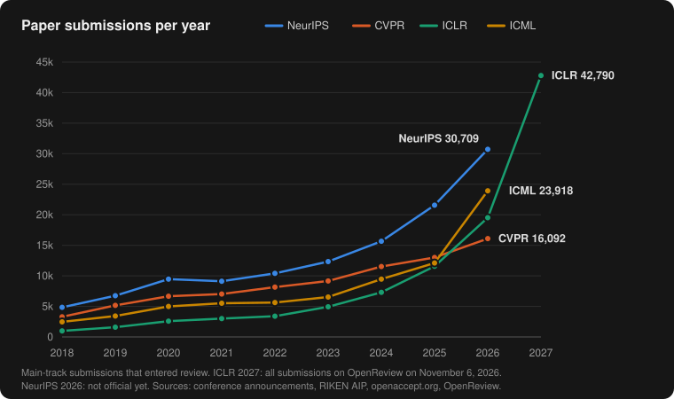

Newton wrote that if he saw further, it was by standing on the shoulders of giants. I have the feeling that today we stand more and more on the shoulders of tokens. Papers drafted with an LLM, code written by an agent, related work summarized by a chatbot... and at the end of the chain, reviews written by the same chatbots. Writing a paper was never so cheap. Reading one with care costs the same as always, a few hours of somebody who knows the topic. And reviewing one takes more and more, because now everything looks shiny, at least on the surface: well written, nice figures, not a single typo.

There is a feeling, very common these days, that getting a paper into a big conference is just a lottery. I wanted to check if there is something behind it, so I went to look at the numbers. The short answer is yes, for a big part of the papers it is quite a lottery.

## The numbers

I take the four big AI conferences as an example, because their growth in the last years is almost exponential. A small disclaimer before going on: I have nothing against these conferences, and the people organizing them are doing a huge job to keep all this working. I talk about them only because they are at the head of the trend. They are the AI community, so they are the ones with the skills today to use AI at full speed, for writing papers and for reviewing them. But soon it will be like this in any conference, of any field.

<div class="post-side" markdown="1">



| Venue | 2019 | Latest | Growth | Accept. rate |
|---|--:|--:|--:|--:|
| CVPR | 5,165 | 16,092 (2026) | ×3.1 | 25.3 % |
| NeurIPS | 6,743 | 21,575 (2025) | ×3.2 | 24.5 % |
| ICML | 3,424 | 23,918 (2026) | ×7.0 | 26.6 % |
| ICLR | 1,591 | 19,525 (2026) | ×12.3 | 27.4 % |

</div>

ICML doubled in one single year, from 12,107 to 23,918. ICLR grew 69 % in 2026 ([their retrospective](https://blog.iclr.cc/2026/03/31/a-retrospective-on-the-iclr-2026-review-process/)), CVPR 24 % ([CVPR](https://cvpr.thecvf.com/Conferences/2026/News/Technical_Program)) and NeurIPS 38 % in 2025 ([the chairs](https://blog.neurips.cc/2025/09/30/reflections-on-the-2025-review-process-from-the-program-committee-chairs/)). Meanwhile the acceptance rate did not move, it has been around 25 % for at least ten years. So the conferences did not raise the bar, they simply take one quarter of whatever arrives. The question is how good the review is at choosing that quarter.

<!-- TODO: NeurIPS 2026 main track. Trackers (openaccept.org) list 30,709 submissions and 7,900 accepted, but I did not find an official number from the chairs. Add it if they publish one. -->

## Reviewing is now really hard

Somebody has to read 20,000 papers, three to five times each. At ICLR 2026, 18,054 reviewers wrote 76,139 reviews, and at NeurIPS 2025 there were 20,518 reviewers for 21,575 papers. Almost one reviewer per paper, and not by chance: there are not enough senior people, so now the authors must review. CVPR made it mandatory in 2025, and even [desk-rejected 19 papers that were already accepted](https://cvpr.thecvf.com/Conferences/2025/CVPRChanges) because their authors had been "highly irresponsible" reviewers. So the people reviewing are the same people submitting, and in a field growing like this most of them are young, PhD students reviewing papers on topics that did not exist when they started.

And here comes the part that worries me most. Today it is extremely difficult to review a paper, because all of them look incredibly good. The writing is polished, the figures are beautiful, the tables are full of bold numbers, the related work cites everything. Either you are a real expert on that exact topic, or it is very easy to trick you. A weak baseline, an ablation that does not really prove anything, a claim that does not follow from the experiments... everything looks fine when you have two hours and five papers to finish. So the number of reviews needed grows exponentially, and the number of reviewers with enough expertise to do them does not.

Then, of course, people also use AI to review. Pangram Labs estimated that [around 21 % of the ICLR 2026 reviews were completely generated by AI](https://www.plagiarismtoday.com/2025/12/04/ai-conference-overrun-with-ai-peer-review/), and more than half had some AI in them (detectors fail, but the order of magnitude is what it is). AAAI 2026 even made it official, and every paper got [one AI review](https://arxiv.org/abs/2604.13940) next to the human ones. And I have to say something a bit uncomfortable here. These AI reviews are still not that good at judging what really matters in a paper, but they catch a lot of factual mistakes that a human with limited time would miss: an equation that is wrong, a number in the text that does not match the table, a reference that does not exist. And they improve every few months. I would not be surprised if very soon they review better than the experts.

## How much is luck

Funny enough, NeurIPS measured this, twice. In [2014](https://arxiv.org/abs/2109.09774) and again in [2021](https://arxiv.org/abs/2306.03262), around 10 % of the papers were reviewed by two independent committees. Of the papers accepted by one committee, around half were rejected by the other one: 49.5 % in 2014, 50.6 % in 2021. Deciding with dice it would be 75 %, and with a perfect committee 0 %. So the review is better than the dice, but closer to the dice than to perfect. And that was 2021, with 9,122 submissions, no LLM reviews and no mandatory reviewing. Nobody repeated the experiment after that.

With a very simple model we can turn this into the question that matters when you submit: given how good my paper is, what are my chances? Every paper has a "merit", the score that an infinite committee of careful reviewers would give it. A real committee sees merit plus some noise (which reviewers you got, if they were tired, if they know the topic, if a model wrote the review) and accepts the top 25 % of what it sees. The amount of noise is the only thing to choose, and the 2021 experiment fixes it. The script is [at the end](#appendix-the-script), if you want to play with it.

This is what comes out:

| Where the paper really is (percentile of merit) | Chance of acceptance |
|---|--:|
| 30th, clearly weak | 7 % |
| 50th, the median | 17 % |
| 75th, just at the line | 40 % |
| 90th, clearly in the top quarter | 65 % |
| 99th | 93 % |

So a paper in the top 10 % is rejected one of every three times, and a median paper, which should be rejected, gets in one of every six. Almost 4 of every 10 accepted papers (38 %) are not in the real top 25 %. And 42 % of the submissions sit in a coin-flip zone, between 20 % and 80 % of chances, which at NeurIPS size means around 9,000 papers. All together, merit explains around one third of the decision. The other two thirds is the committee you got.

And this is the optimistic version, with the noise of 2021. If today the noise were double, which I don't find crazy at all, a top-10 % paper would be almost a coin flip (54 %), and merit would explain only one fifth of the decision.

## Two good papers or ten so-so ones?

If you lead a group and you know these numbers, what do you do? A rejection says very little about the paper, so you send it again to the next deadline. And now that AI helps you to write, you send more papers, even if the work is still in an early stage.

I made a small experiment with the same model. Two labs of the same size. Lab A works on one big idea per year, and produces one very good paper (top 5 % of the submissions) and one good paper (top 20 %). Lab B uses AI a lot and sends ten papers per year, all of them early-stage work, below the median (40th percentile). Both resubmit what gets rejected, up to three deadlines per year, more or less what CVPR, ICCV/ECCV and NeurIPS give you.

| | **Lab A**<br><small>1 very good + 1 good paper per year</small> | **Lab B**<br><small>10 below-median papers per year</small> |
|---|--:|--:|
| Accepted papers per year | 1.8 | 3.0 |
| Accepted papers after 5 years | 9 | 15 |
| Same, if the noise is double | 9 | 20 |
| Reviews it costs per year (~4 per submission) | ~12 | ~107 |

After five years, lab B has a longer list of top-venue papers than lab A in 94 % of the simulations (100 % if the noise is double). If its ten papers are just median instead of below it, it ends with 21 papers against 9. And it costs nine times more reviews, from the same few experts.

So the incentives are very clear, and the circle closes: more papers, more reviews, the same few experts, more noise, a rejection means less, more papers. Nobody needs to cheat for this, everybody is just doing what makes sense for them.

And here is the real problem. Labs and PIs are evaluated by number of papers and by citations, for positions, for grants, for promotions. With these numbers lab B looks almost twice as productive as lab A, while lab A is the one pushing the state of the art. And citations don't fix it, because more and more they are also generated: a related work written by an LLM cites whatever is easy to find, and ten papers per year cite each other. So the way we have to see who is doing relevant research is broken. The only way left is to read the papers, which is exactly what nobody has time to do.

## What now?

Quality still matters, in the model it decides the odds. The problem is that we read every decision as a verdict, when it is more like one throw of loaded dice. If you are a student, a rejection is not a verdict about you, and don't take an acceptance too seriously either :) If you evaluate people, better to read three papers carefully than to count thirty. And conferences should at least measure and publish their own noise every year, and maybe say openly that the middle zone is a lottery, like the Swiss National Science Foundation does since 2021, when it [draws lots among the proposals that the panel cannot separate](https://en.wikipedia.org/wiki/Funding_by_lottery).

But honestly, I think all this is only the beginning. The research model is changing paradigm at a speed that we cannot even react to. Machines already write a good part of the papers, soon they will review them better than us, and probably they will do a good part of the research too. And then we humans start to be just the bottleneck. Limited brains where the whole process has to stop by, so somebody can explain to us what was done, as if we were 7 years old.

Standing on the shoulders of tokens, then. I still don't know what to think about it, but it is coming, and fast.

## Appendix: the script

It only needs Python, no libraries. The other numbers in the post come from the same model.

```python
# Merit + noise model of peer review, calibrated on the NeurIPS 2021 consistency experiment.
# Merit Q ~ N(0,1). Committee score C = sqrt(r)*Q + sqrt(1-r)*noise. Accept the top `a`.
# Two independent committees then have corr(C1, C2) = r.
from statistics import NormalDist
from math import sqrt
N = NormalDist()

def both_accept(t, rho, n=4000):  # P(X > t and Y > t), standard bivariate normal
    h = (8 - t) / n
    return h * sum(N.pdf(x) * (1 - N.cdf((t - rho * x) / sqrt(1 - rho**2)))
                   for x in (t + (i + .5) * h for i in range(n)))

def flip(r, a):  # P(committee B rejects | committee A accepts)
    return 1 - both_accept(N.inv_cdf(1 - a), r) / a

def p_accept(pct, r, a):  # P(accept) for a paper at merit percentile pct
    return 1 - N.cdf((N.inv_cdf(1 - a) - sqrt(r) * N.inv_cdf(pct)) / sqrt(1 - r))

a = 0.257                       # NeurIPS 2021 acceptance rate
lo, hi = 0.0, 0.999             # find r such that 50.6% of accepted papers flip
for _ in range(50):
    r = (lo + hi) / 2
    lo, hi = (r, hi) if flip(r, a) > 0.506 else (lo, r)
print(f"r = {r:.3f}, corr(score, merit) = {sqrt(r):.3f}")
for pct in [0.30, 0.50, 0.70, 0.75, 0.90, 0.95, 0.99]:
    print(f"merit percentile {pct:.0%}: P(accept) = {p_accept(pct, r, a):.0%}")

# Two labs, rejected papers resubmitted up to 3 times per year, 25 % acceptance
def accepted_per_year(papers, tries=3):
    return sum(1 - (1 - p_accept(q, r, 0.25)) ** tries for q in papers)
print(f"lab A: {accepted_per_year([0.95, 0.80]):.1f}, lab B: {accepted_per_year([0.40] * 10):.1f}")
```
